  <picture>
    <source media="(prefers-color-scheme: dark)" srcset="assets/hero-dark.svg" />
    
  </picture>

  <picture>
    <source media="(prefers-color-scheme: dark)" srcset="https://readme-typing-svg.demolab.com?font=JetBrains+Mono&weight=500&size=18&duration=3000&pause=1200&color=2DD4BF&center=true&vCenter=true&width=480&height=36&lines=Software%20Engineer%20%D1%88%D0%B8%D1%80%D0%BE%D0%BA%D0%BE%D0%B3%D0%BE%20%D0%BF%D1%80%D0%BE%D1%84%D0%B8%D0%BB%D1%8F;%D0%A5%D0%BE%D1%87%D1%83%20%D0%B2%D0%B8%D0%B4%D0%B5%D1%82%D1%8C%20IT-%D0%BF%D1%80%D0%BE%D1%86%D0%B5%D1%81%D1%81%20%D1%86%D0%B5%D0%BB%D0%B8%D0%BA%D0%BE%D0%BC;%D0%90%D0%BB%D0%B3%D0%BE%D1%80%D0%B8%D1%82%D0%BC%D1%8B%2C%20%D0%B3%D1%80%D0%B0%D1%84%D1%8B%20%D0%B8%20%D1%81%D1%82%D1%80%D1%83%D0%BA%D1%82%D1%83%D1%80%D1%8B%20%D0%B4%D0%B0%D0%BD%D0%BD%D1%8B%D1%85;Frontend%2C%20backend%2C%20%D0%B4%D0%B0%D0%BD%D0%BD%D1%8B%D0%B5%20%D0%B8%20ML;%D0%9E%D1%82%20%D1%82%D1%80%D0%B5%D0%B1%D0%BE%D0%B2%D0%B0%D0%BD%D0%B8%D0%B9%20%D0%B8%20%D1%81%D1%85%D0%B5%D0%BC%20%D0%B4%D0%BE%20%D1%80%D0%B5%D0%BB%D0%B8%D0%B7%D0%B0;%D0%A8%D0%B2%D0%B5%D0%B9%D1%86%D0%B0%D1%80%D1%81%D0%BA%D0%B8%D0%B9%20%D0%BD%D0%BE%D0%B6%2C%20%D0%B0%20%D0%BD%D0%B5%20%D0%BE%D0%B4%D0%BD%D0%B0%20%D0%BE%D1%82%D0%B2%D1%91%D1%80%D1%82%D0%BA%D0%B0" />
    
  </picture>

  
  
  

## <samp>01 /</samp> Обо мне

Мне интересно понимать, как устроено всё целиком: от алгоритма и модели данных до интерфейса, инфраструктуры и того, как над этим работает команда. Ориентир — инженеры, которые в одиночку могли собрать что угодно. Швейцарский нож, а не одна отвёртка.

Поэтому в моих проектах встречается разное: frontend на React и TypeScript, бэкенды на Node.js, Rust и Python, численные методы и ML, блокчейн TON и команды ИИ-агентов. Особенно люблю алгоритмы и интерфейсы для сложных данных — графы, графики, таблицы.

В командах беру на себя не только код: разбираю требования, рисую схемы, планирую работу и с удовольствием выступаю PM.

Выпускник СПбГУ, ПМ-ПУ, «Программирование и информационные технологии», 2026. Живу в Санкт-Петербурге.

## <samp>02 /</samp> Избранные проекты

<table>
  <tr>
    <td width="50%" valign="top">
      <samp>команда</samp> 
      <b><a href="https://github.com/LeshBerz/Graph-Theory-project">Graph Theory project</a></b> 
      Веб-приложение для анализа и визуализации графов: свойства, расстояния, кластеризация, экспорт в CSV. 
      Роль: frontend · системный аналитик · PM  
      
      
      
      
    </td>
    <td width="50%" valign="top">
      <samp>соло</samp> 
      <b><a href="https://github.com/LeshBerz/crypto-price-tracker">Crypto Price Tracker</a></b> 
      Цены криптовалют из CoinMarketCap: фоновая синхронизация, история в SQLite, REST API и веб-клиент со свечными графиками. 
      Роль: автор — API и веб-клиент  
      
      
      
      
    </td>
  </tr>
  <tr>
    <td width="50%" valign="top">
      <samp>соло</samp> 
      <b><a href="https://github.com/LeshBerz/greenline">Greenline</a></b> 
      Веб-чат поверх GREEN-API: отправка и получение сообщений, статусы доставки, повтор неотправленного. 
      Роль: автор, frontend  
      
      
      
    </td>
    <td width="50%" valign="top">
      <samp>соло + ИИ-агенты</samp> 
      <b><a href="https://github.com/LeshBerz/o-complex-ai-assistant">ИИ-ассистент менеджера O-complex</a></b> 
      RAG по базе знаний: черновик ответа клиенту и подсказка по допродаже, интеграция с amoCRM. 
      Роль: тимлид команды ИИ-агентов в Claude Code  
      
      
      
      
    </td>
  </tr>
  <tr>
    <td width="50%" valign="top">
      <samp>соло</samp> 
      <b><a href="https://github.com/LeshBerz/Credit-Calculator">Credit Calculator</a></b> 
      Оценка кредитов на нечёткой логике (алгоритм Мамдани) с графиками зависимостей. 
      Роль: frontend  
      
      
      
      
    </td>
    <td width="50%" valign="top">
      <samp>команда</samp> 
      <b><a href="https://github.com/LeshBerz/Trudion">Trudion</a></b> 
      Веб-приложение для поиска единомышленников. 
      Роль: frontend · системный аналитик · PM  
      
      
      
      
    </td>
  </tr>
</table>

## <samp>03 /</samp> Стек

  <picture>
    <source media="(prefers-color-scheme: dark)" srcset="https://skillicons.dev/icons?i=js%2Cts%2Creact%2Cnextjs%2Cvue%2Ctailwind%2Cmaterialui%2Credux%2Cvite%2Cjest&theme=dark&perline=10" />
    
  </picture>
   
  <picture>
    <source media="(prefers-color-scheme: dark)" srcset="https://skillicons.dev/icons?i=nodejs%2Cexpress%2Cnestjs%2Cgo%2Crust%2Cpy%2Ccpp%2Cpostgres%2Csqlite%2Cdocker&theme=dark&perline=10" />
    
  </picture>

  
  
  
  
  

| Направление | Технологии |
|---|---|
| Frontend | JavaScript, TypeScript, React, Next.js, Vue, Tailwind CSS, Material UI, Redux, Vite, Jest |
| Backend и данные | Node.js, Express, NestJS, PostgreSQL, SQLite, Docker |
| Языки | TypeScript, JavaScript, Python, C++, Go, Rust |
| Аналитика и менеджмент | Miro, PlantUML, LaTeX, OpenAPI, Claude Code |

## <samp>04 /</samp> Статистика

  <picture>
    <source media="(prefers-color-scheme: dark)" srcset="https://github-readme-stats.vercel.app/api?username=LeshBerz&show_icons=true&hide_border=true&hide_rank=true&bg_color=00000000&title_color=2dd4bf&icon_color=2dd4bf&text_color=e8eaed&locale=ru" />
    
  </picture>
  <picture>
    <source media="(prefers-color-scheme: dark)" srcset="https://github-readme-stats.vercel.app/api/top-langs/?username=LeshBerz&layout=compact&langs_count=8&hide_border=true&bg_color=00000000&title_color=2dd4bf&text_color=e8eaed&locale=ru" />
    
  </picture>

<b>Весь путь: школа → университет</b>

 

**Школа.** Кумир (7 класс) → консольные приложения на C# → Pascal → HTML, CSS, JS и первые сайты → Python и ЕГЭ по информатике (11 класс).

**Университет, СПбГУ ПМ-ПУ**

- **Основы программирования (C++)** — длинная арифметика, машина Поста, архиватор, AA-дерево, очередь с приоритетом, минимальное остовное дерево. [AMCP-PIT-Homework](https://github.com/LeshBerz/AMCP-PIT-Homework)
- **Первая игра на Unity (C#)** — аркада JumpOn с процедурной генерацией платформ. [JumpOn](https://github.com/LeshBerz/JumpOn)
- **Анализ российских акций (Python)** — API MOEX, pandas, matplotlib. [stock_exchange_analytics](https://github.com/LeshBerz/stock_exchange_analytics)
- **Вычислительная математика (Python)** — LU/QR-разложения, метод Ньютона, численное интегрирование. [Computational-mathematics](https://github.com/LeshBerz/Computational-mathematics)
- **Машинное обучение** — регрессия, классификация, бустинг, кластеризация, снижение размерности.
- **Базы данных** — SQL, PostgreSQL, XQuery и BaseX.
- **Учебная практика (Rust)** — симулятор исполнения заявок на бирже, роль системного аналитика, отчёт на 30+ страниц. [execution](https://github.com/LeshBerz/execution) · [страница проекта](https://citec.spb.ru/projects/exchange-simulator-autumn2024#team) · [отчёт](https://disk.yandex.ru/i/0_nYaAjitT2hsQ)
- **Web-программирование** — Trudion, Vue + Go, роли frontend, аналитик и PM. [Trudion](https://github.com/LeshBerz/Trudion)
- **Credit Calculator** — нечёткая логика на React + TS, LaTeX-отчёт на 40+ страниц. [Credit-Calculator](https://github.com/LeshBerz/Credit-Calculator)
- **Tracker-Lite** — задачи и доски с drag-and-drop на React, Redux Toolkit, Docker. [Avito-Tracker-Lite](https://github.com/LeshBerz/Avito-Tracker-Lite)
- **Программная инженерия кибериммунных систем (Python)** — модуль электронной подписи для платформы автономных транспортных систем, роли разработчика, аналитика и PM. [cyberimmune-autonomy](https://github.com/LeshBerz/cyberimmune-autonomy--chvt-preview)
- **Теория графов** — веб-приложение для анализа графов, роли frontend, аналитик и PM. [Graph-Theory-project](https://github.com/LeshBerz/Graph-Theory-project)
- **Моделирование информационных процессов (Python)** — LQR-стабилизация маятника в PyBullet. [mip-pendulum-stabilization](https://github.com/LeshBerz/mip-pendulum-stabilization)
- **ВКР (2026)** — архитектура клиента Web3-платформы Achieva: Telegram Mini App и блокчейн TON.

  <picture>
    <source media="(prefers-color-scheme: dark)" srcset="assets/divider-dark.svg" />
    
  </picture>
   
  <samp>leshberz.ru</samp>

